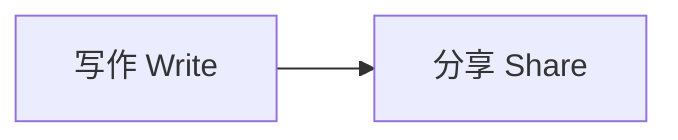

token keep token

# Hello export 中文

Editable **strong** text 😀 and a note[^n].

| Name | Detail |
| --- | --- |
| Original | 译文 |

Math $x^2$ and $\ce{H2O}$.

## Final heading

Complete end marker.

[^n]: Footnote content.
