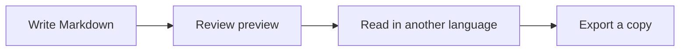

# Markdown conventions {#conventions}

[TOC]

Open Preferences → Plugins to change the optional conventions. Opt, LaTeX and
Mermaid start enabled. Enable GitHub for callouts and Typora for YAML front matter
and the TOC here.

## Prose and inline formatting

"Smart quotes", an author's apostrophe, dashes -- like this -- and an ellipsis...
render without changing the Markdown source.

**Bold**, *emphasis*, ~~strikethrough~~, ==highlighted **text**==, H~2~O and x^2^.

Literal code: `==highlight==`, `~~deleted~~`, `$x^2$` and `"quotes" -- ...`.
Escaped markers: \==literal== and \[TOC].

## Tables and tasks

| Feature | Example | Status |
| :--- | :---: | ---: |
| Table alignment | centered | 1 |
| Escaped pipe | a\|b | 2 |
| Inline code | `x + y` | 3 |

- [x] Write the source
- [ ] Review the rendered document
- [ ] Export a copy

## Notes and links

This note has two references[^note], including this repeated reference[^note].

An explicit [HTTPS link](https://example.com), a CommonMark autolink
<https://example.com>, and a GitHub literal: https://example.com/path_(balanced).

[^note]: Footnotes support **formatting** and multiple paragraphs.

    The return link leads back to the reference.

## GitHub alerts

> [!NOTE]
> Useful context for the reader.

> [!TIP]
> A helpful suggestion with ==highlighted text==.

> [!IMPORTANT]
> Keep these details in mind.

> [!WARNING]
> Review before continuing.
>
> - A list can be part of an alert.

> [!CAUTION]
> Take care when editing shared information.

## Formulas

Inline $E = mc^2$ and parenthesized \(a^2+b^2=c^2\).

$$
f(x)=\begin{cases}x^2&x\geq0\\-x&x<0\end{cases}
$$

More examples are in the adjacent LaTeX gallery.

## Footnotes

Named notes[^named] and inline notes^[An inline note with **emphasis**, `code ]`
and $x_2$] share one numbering sequence.

The named note can be referenced again[^named].

[^named]: A named note body.

## Literal disclosure tags

These tags remain visible, including when sanitized HTML is enabled:

Literal title

**Markdown inside still renders.**

## Mermaid

## Code remains literal

~~~markdown
==highlight== $x^2$ [TOC]
> [!TIP]
> Source inside a code fence stays literal.
~~~

### A nested section {#nested .example}

The TOC links to this explicit anchor without displaying the attribute syntax.

## 中文标题

Unicode heading anchors also work in the TOC and exported HTML.
